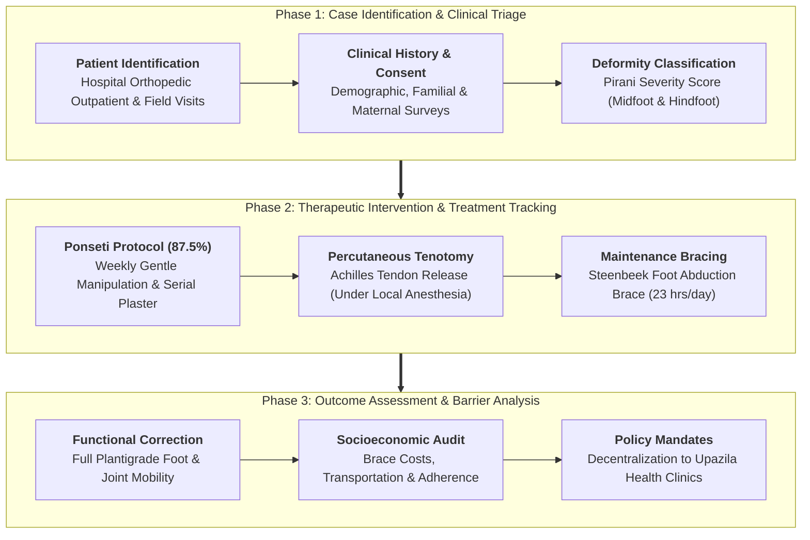
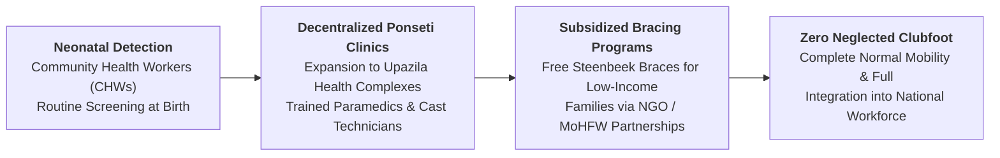

# Epidemiological and Clinical Case Study on Clubfoot (CTEV) in Bangladesh

**Author(s):** Md Nehamul Islam Nehad, Sunayda Jahan Sruty, Ridoy Chandra Roy, Md Abu Sadat Soash, Shatabdi Roy, Alvee Alam, Jahidul Islam Shovo, Shadman Mutassim Efad  
*Department of Genetic Engineering and Biotechnology*<br>
*Shahjalal University of Science and Technology, Sylhet, Bangladesh*

[](#1-clinical-background--healthcare-challenge)
[](#2-clinical-study-design--patient-cohort)
[](#2-clinical-study-design--patient-cohort)

---

## Abstract

* **Objective:** Congenital Talipes Equinovarus (CTEV), commonly known as clubfoot, is a major pediatric structural deformity characterized by hindfoot equinus, varus, midfoot cavus, and forefoot adduction. In Bangladesh, an estimated 5,000 children are born with clubfoot annually ($\approx 1\ \text{in}\ 900$ live births). If untreated, the condition leads to lifelong physical disability, social stigmatization, and chronic economic dependency. This study investigates the clinical presentations, therapeutic outcomes, genetic recurrence risks, and socioeconomic bottlenecks governing clubfoot management in Bangladesh.
* **Methodology:** An epidemiological and clinical survey was conducted across hospital visits and door-to-door community field evaluations in multiple districts of Bangladesh, capturing comprehensive histories for **16 clinical cases** (ages 34 days to 55 years). Data collection assessed deformity classification (Pirani score, unilateral vs. bilateral), treatment interventions (the non-invasive **Ponseti method** comprising serial plaster casting, percutaneous Achilles tenotomy, and foot abduction bracing vs. major surgical correction), familial multi-generational inheritance, and maternal prenatal monitoring.
* **Findings:** Of the 16 cases evaluated, **56.25% were male ($n=9$)** and **43.75% were female ($n=7$)**. The conservative **Ponseti method** was the primary therapeutic intervention in **87.5% of managed cases ($n=14$)**, yielding high rates of anatomical correction without extensive joint-stiffening surgery. Only two complex cases required major surgical intervention, while one adult case (55 years) remained completely untreated due to extreme socioeconomic deprivation. Familial history was documented in 12.5% of cases ($n=2$), indicating sporadic etiology in the majority of patients with potential multi-factorial or oligogenic inheritance (e.g., 17q23 chromosomal microduplications). Acute recurrent expenses for progressive Steenbeek brace replacement (\$5–\$10 per pair) and regional travel distances to the 44 existing national Ponseti clinics were identified as the primary causes of treatment non-adherence.
* **Implications:** Decentralizing Ponseti treatment facilities to sub-district Upazila Health Complexes, establishing subsidized orthotic device distribution, and integrating neonatal foot screening into national community healthcare worker training are vital policy mandates to achieve zero-neglected-clubfoot in Bangladesh.

---

## 1. Clinical Background & Healthcare Challenge

Congenital Talipes Equinovarus (CTEV) is among the most frequent congenital structural musculoskeletal anomalies. Without intervention, infants develop severe walking impairments, walking on the outer borders or dorsum of their inverted feet, leading to painful calluses, secondary infections, and inability to attend school or attain productive employment.

```
                    Congenital Clubfoot (CTEV) Delivery
                                     │
                 ┌───────────────────┴───────────────────┐
                 ▼                                       ▼
        Early Neonatal Detection               Delayed / Neglected Presentation
         (Within First 1–3 Weeks)                (Late Infancy to Adulthood)
                 │                                       │
                 ▼                                       ▼
       The Ponseti Technique:                  Structural Skeletal Deformity:
       • Gentle manual manipulation            • Rigid joint contractures
       • 4–6 weekly plaster casts              • Painful weight-bearing on dorsum
       • Percutaneous Achilles tenotomy        • Requires extensive joint fusion
       • Steenbeek abduction brace               or osteotomies; permanent limp
                 │                                       │
                 ▼                                       ▼
       Complete Functional Foot &              Severe Lifelong Physical &
         Near-Normal Mobility                    Economic Disability
```

1. **The Ponseti Revolution:** Historically managed through invasive posteromedial soft-tissue release surgeries that resulted in stiff, painful, arthritic feet in adulthood, modern clubfoot management relies on the Ponseti method. Developed by Dr. Ignacio Ponseti, it gently stretches contracted ligaments and realigns tarsal bones through biological tissue remodeling, achieving $>95\%$ success when initiated in early infancy.
2. **The Socioeconomic Hurdle in Bangladesh:** While serial casting is nominally free in government hospitals, low-income families struggle with indirect costs: repeated hospital transit from rural villages, lost daily wages, and recurrent out-of-pocket costs for dynamic foot abduction braces (FAB) as children rapidly outgrow them.
3. **Study Aims:** This investigation documents primary patient case histories to assess clinical variation, treatment compliance, and socioeconomic determinants influencing pediatric orthopedic outcomes in Bangladesh.

---

## 2. Clinical Study Design & Patient Cohort

The study evaluated **16 clinical cases** spanning diverse patient ages, geographic regions, and clinical presentations across Bangladesh:

| Clinical / Demographic Metric | Stratified Breakdown ($N=16$) | Percentage (%) | Clinical Significance |
| :--- | :--- | :---: | :--- |
| **Sex Distribution** | Male ($n=9$)<br>Female ($n=7$) | **56.25%**<br>43.75% | Aligns with global male predominance in congenital CTEV ($\sim 2:1$) |
| **Age Spectrum** | Infants & Toddlers (34 days – 3.5 yrs)<br>Children & Adolescents (8 – 22 yrs)<br>Untreated Adult (55 yrs) | **68.75% ($n=11$)**<br>25.00% ($n=4$)<br>6.25% ($n=1$) | Majority presented during ideal Ponseti intervention window;<br>highlights consequences of neglected adult clubfoot |
| **Laterality & Presentation** | Unilateral (Left or Right)<br>Bilateral Deformity | **50.00% ($n=8$)**<br>**50.00% ($n=8$)** | Equal distribution between single-limb and bilateral involvement |
| **Therapeutic Modality** | **Ponseti Method** (Casting + Bracing)<br>Major Invasive Surgery<br>Completely Untreated / Abandoned | **87.50% ($n=14$)**<br>12.50% ($n=2$)<br>6.25% ($n=1$) | Confirms strong national adoption of non-invasive Ponseti protocols;<br>surgery reserved for neglected / recurrent cases |
| **Etiological / Genetic History** | Sporadic (No family history)<br>Positive Multi-Generational History | **87.50% ($n=14$)**<br>**12.50% ($n=2$)** | Sporadic occurrence dominates; familial cases suggest underlying<br>autosomal dominant with reduced penetrance or microduplications |

---

## 3. Clinical Workflow Architecture



---

## 4. Key Findings & Healthcare Bottlenecks

### 4.1 High Efficacy of the Non-Invasive Ponseti Protocol
Across 14 patients managed with the Ponseti technique, serial plaster manipulation successfully corrected midfoot cavus, forefoot adduction, and heel varus within 4 to 7 casting rounds. Percutaneous Achilles tenotomy effectively corrected rigid residual equinus under local anesthesia in an outpatient setting without requiring general anesthesia or expensive operating theater bookings.

### 4.2 Economic Barriers & The Orthotic Maintenance Phase
While casting achieves primary anatomical correction, maintaining alignment requires the child to wear a **Foot Abduction Brace (FAB / Steenbeek brace)** 23 hours a day for the first 3 months, followed by nighttime wear up to age 4 to 5 years:
* **The Recurrent Cost Challenge:** A pair of locally manufactured Steenbeek braces costs approximately **\$5 to \$10** (production cost \$3–\$5). For rural agrarian families earning minimal daily wages, the requirement to purchase 4 to 6 pairs as the child outgrows them creates a major financial hazard.
* **Non-Compliance & Relapse:** Two surveyed cases experienced deformity relapse directly caused by premature discontinuation of brace wear due to parental inability to afford replacement shoes or travel to district fitting centers.

```
                     ┌────────────────────────────────────────┐
                     │          Economic Disparity            │
                     │          ──────────────────            │
                     │  • Brace cost: $5 - $10 / pair         │
                     │  • Multiple pairs needed as baby grows │
                     │  • Direct cause of treatment drop-out  │
                     └────────────────────────────────────────┘

                     ┌────────────────────────────────────────┐
                     │       Infrastructure Bottleneck        │
                     │       ─────────────────────────        │
                     │  • 44 Ponseti clinics nationwide       │
                     │  • Only 3 in specialized hospitals     │
                     │  • Rural families face travel costs    │
                     └────────────────────────────────────────┘
```

### 4.3 Genetic Architecture & Maternal Prenatal Factors
* **Familial Clustering (Case 8 & Case 15):** Two patients displayed multi-generational occurrence (affected uncles/siblings), consistent with genetic literature documenting incomplete penetrance linked to the **17q23 chromosomal region (containing *PITX1* and *TBX4*)**.
* **Maternal Health & Nutrition:** In multiple interviews, mothers reported a lack of prenatal folate supplementation, unattended home deliveries, and unmonitored pregnancies, highlighting the critical role of maternal healthcare education in early diagnosis.

---

## 5. Repository Documentation & Study Assets

| Document Asset | Format | Detailed Contents & Analytical Description |
| :--- | :---: | :--- |
| **[`Case Study on Clubfoot.pdf`](Case%20Study%20on%20Clubfoot.pdf)** | Academic Report | Complete research document containing comprehensive case narratives for all 16 patients, clinical photographic records, Pirani scores, treatment timelines, and discussion. |
| **[`Case Study on Clubfoot presentation.pptx`](Case%20Study%20on%20Clubfoot%20presentation.pptx)** | Presentation | 14-slide academic symposium slide deck detailing epidemiology in Bangladesh, treatment protocols, and photographic case analyses. |
| **[`Case Study on Clubfoot info collection form.docx`](Case%20Study%20on%20Clubfoot%20info%20collection%20form.docx)** | Clinical Questionnaire | Standardized clinical survey instrument and informed patient consent protocol utilized during field interviews and hospital evaluations. |
| **[`Case Study team information.pdf`](Case%20Study%20team%20information.pdf)** | Metadata | Student investigator profiles, academic degrees, and contact details of the eight research co-investigators. |
| **[`Chromosomal Disorders in BD.pdf`](Chromosomal%20Disorders%20in%20BD.pdf)** | Topic Discovery | Exploratory epidemiological survey assessing congenital chromosomal anomalies in Bangladesh (CTEV, Cleft Palate, Trisomies, Beta-Thalassemia). |

---

## 6. Repository Organization

```text
clubfoot-case-study-bd/
├── Case Study on Clubfoot.pdf                       # Comprehensive 16-case clinical research report
├── Case Study on Clubfoot presentation.pptx         # 14-slide academic evaluation presentation
├── Case Study on Clubfoot info collection form.docx # Field survey and clinical consent questionnaire
├── Case Study team information.pdf                  # Research team profiles and contact sheet
├── Chromosomal Disorders in BD.pdf                  # Epidemiological survey of genetic disorders in BD
├── .gitignore                                       # Git ignore rules
└── README.md                                        # Master clinical case study documentation
```

---

## 7. Translational Roadmap & Policy Recommendations



1. **Decentralization to Primary Care:** Expand Ponseti casting units from the 44 existing centers into rural Upazila (sub-district) Health Complexes to eliminate prohibitive transportation costs for impoverished families.
2. **Universal Free Orthotic Distribution:** Partner with humanitarian orthotics programs (e.g., expanding *Walk for Life* / *Zero Clubfoot Project*) to provide free, standardized Steenbeek foot abduction braces to all registered patients until age 5.
3. **Training Community Health Workers:** Train grassroots community health workers and midwives to identify CTEV within the first 72 hours of birth and provide immediate referrals before tendon stiffness sets in.

---

## 8. Authorship, Inquiries & Correspondence

### Research Investigators
- **Md Nehamul Islam Nehad**
- **Sunayda Jahan Sruty**
- **Ridoy Chandra Roy**
- **Md Abu Sadat Soash**
- **Shatabdi Roy**
- **Alvee Alam**
- **Jahidul Islam Shovo**
- **Shadman Mutassim Efad**

*Department of Genetic Engineering and Biotechnology, Shahjalal University of Science and Technology, Sylhet, Bangladesh*

### Academic Inquiries
For questions regarding the clinical case data, questionnaire formats, or collaborative pediatric orthopedics initiatives, please contact:
- **Email:** [mdabu13@student.sust.edu](mailto:mdabu13@student.sust.edu)
- **Institution:** [Shahjalal University of Science and Technology](https://www.sust.edu/)
- **Department:** [Department of Genetic Engineering and Biotechnology](https://www.sust.edu/departments/geb)

---

## 9. References & Data Sources

1. **Ministry of Health and Family Welfare (MOHFW).** *National Strategy and Action Plan for Clubfoot Care in Bangladesh*. Government of the People's Republic of Bangladesh.
2. **Walk for Life (WFL).** *The National Clubfoot Program of Bangladesh: Clinical Guidelines and Progress*.
3. **Ponseti, I. V. (1996).** *Congenital Clubfoot: Fundamentals of Treatment*. Oxford University Press.
4. **Dobbs, M. B., & Gurnett, C. A. (2009).** Genetics of clubfoot. *Journal of Pediatric Orthopaedics B*, 18(1), 7–9.
5. **Gurnett, C. A., et al. (2010).** 17q23 microduplications, including *PITX1*, are a cause of congenital clubfoot. *The American Journal of Human Genetics*, 87(2), 274–281.
6. **Global Clubfoot Initiative (GCI).** *Bangladesh Country Profile and Treatment Access Survey*. [https://globalclubfoot.com](https://globalclubfoot.com).
